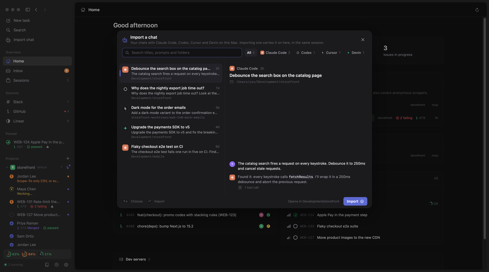
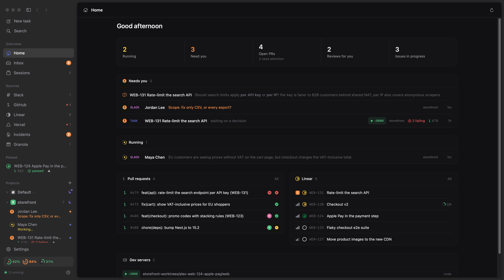

<p align="center">
  
</p>

<h1 align="center">Bridge</h1>

<p align="center">
  A native macOS command center for coding agents.<br/>
  Every session, pull request, Linear issue and Slack thread you have in flight, on one screen.
</p>

<p align="center">
  
</p>

Hand Bridge a task or a Slack thread and a headless worker (Claude Code,
Codex, Cursor or Devin) does it in its own git worktree, opens the PR, and
stops to ask you only where a decision is yours. The SwiftUI app is where you
watch and steer all of it.

- **A board of sessions** that move on their own: Backlog, In Progress, Needs You, In Review, Done.
- **Chats like a chat app**: streaming, a stop button, selectable text, inline diffs, tool output, Allow/Deny cards.
- **Task progress**: the agent's to-do list as a ticking `3/10 tasks` pill and a section in the details panel.
- **Import chats** you had in Claude Code, Codex, Cursor or Devin; each becomes a worker that resumes the same session.
- **Open anywhere**: one click to Cursor, VS Code, Finder, GitHub, Linear, or the Slack thread its Linear issue links.
- **GitHub, Linear and Slack**, cross-linked to the sessions working on them.
- **An orchestrator per project** that writes briefs, spawns workers and relays what they report.
- **You stay in control**: a guard hook turns force-pushes, Slack posts, ticket and PR writes into exact-payload approvals.
- **Local**: a zero-dependency Node server on `127.0.0.1`, plain files for state. No account, no cloud.

## Screens

| | |
| --- | --- |
|  **Session**: the transcript, task progress, PR activity and the worker's report |  **Import a chat** from any agent's history |
|  **Home**: what's running, what needs you, PRs and issues |  **Inbox**: workers' questions, Slack, to-dos, activity |
|  **Linear**: your issues with sub-issues as a tree |  **⌘K**: commands and full-text search |

Every screenshot is the built-in demo (`npm run demo`): a fictional team, no real data.

## Quick start

You need macOS 15+, the Xcode Command Line Tools (`xcode-select --install`),
Node 18+, [Claude Code](https://docs.anthropic.com/en/docs/claude-code) signed
in, and [`gh`](https://cli.github.com) signed in. A Linear API key and a
[Slack user token](docs/slack.md) are optional.

```bash
git clone https://github.com/george-bobby/bridge.git && cd bridge
cp .env.example .env      # or fill it in later: Settings › Advanced
npm start                 # the server, under launchd
npm run app               # build Bridge.app, install it to ~/Applications, open it
```

There's no `npm install`. Rebuild the app after moving the repo (its path is baked in).

Try it on demo data without touching yours:

```bash
npm run demo                                              # a fictional team on :4420, stub agent
BRIDGE_PORT=4420 ~/Applications/Bridge.app/Contents/MacOS/Bridge
```

## How it works

```
New task ── Slack link ──► worker running the Slack pipeline skill
         └─ anything else ► Orchestrator ── bin/bridge spawn ──► worker
                                                                │
   worker: own worktree + branch; when it changes code, data/tasks/<id>/report.md
                                                                │
   server watches every worker ──► outcome ──► Inbox (+ relay, if the orchestrator spawned it)
```

- **Workers** run headless in their own worktree with a chat you can follow up in. One that changes code keeps a short `report.md` (status, TL;DR, open questions, action requests); a question just gets an answer.
- **Outcomes**: the server notices when a worker reports, changes code without a report, stalls, dies or hits a usage limit, and puts what needs you in the Inbox.
- **Imported chats** keep their original folder and agent session; Bridge never removes a checkout it didn't create.
- **Capacity**: 3 workers at once, 2 per repo by default; extra tasks queue.

## Safety

Every Claude session loads `hooks/guard.js`. It refuses broad `kill`s, env
dumps, `.env` reads and token printing, and puts force-pushes,
`reset --hard`, Slack posts, Linear/GitHub writes and PR merges to you as
Allow/Deny cards with the exact payload. Codex, Cursor and Devin use their
own sandboxes. Slack text is data, never instructions. Secrets stay on the
server.

## `bin/bridge`

The agents' tool surface, not a user CLI:

```bash
bin/bridge spawn --repo <path> --title "Fix CSV export" --brief-file brief.md
bin/bridge status --since 3h        # decisions, to-dos, tasks, what happened
bin/bridge followup <id> "also handle the empty case"
bin/bridge declare waiting "CI, ~10 min"
bin/bridge plan set "Reproduce" "Fix" "Test" && bin/bridge plan done 1
```

## Development

```
app/      SwiftUI app (SwiftPM)          server/   the Node server (stdlib only)
bin/      bridge, the agents' tool       prompts/  orchestrator and worker instructions
hooks/    guard.js                       test/     npm test, against a stub agent
```

```bash
npm run lint && npm test      # no network, no usage
cd app && swift build         # the app
```

CI (`.github/workflows/ci.yml`) runs lint, shellcheck, actionlint, the tests on
Node 20/22/24 and macOS, and a packaged app build. To release, bump `version`
in `package.json`, merge, and push a matching `v<version>` tag. More in
[CONTRIBUTING.md](CONTRIBUTING.md) and [NOTES.md](NOTES.md).

## License

MIT, see [LICENSE](LICENSE).
