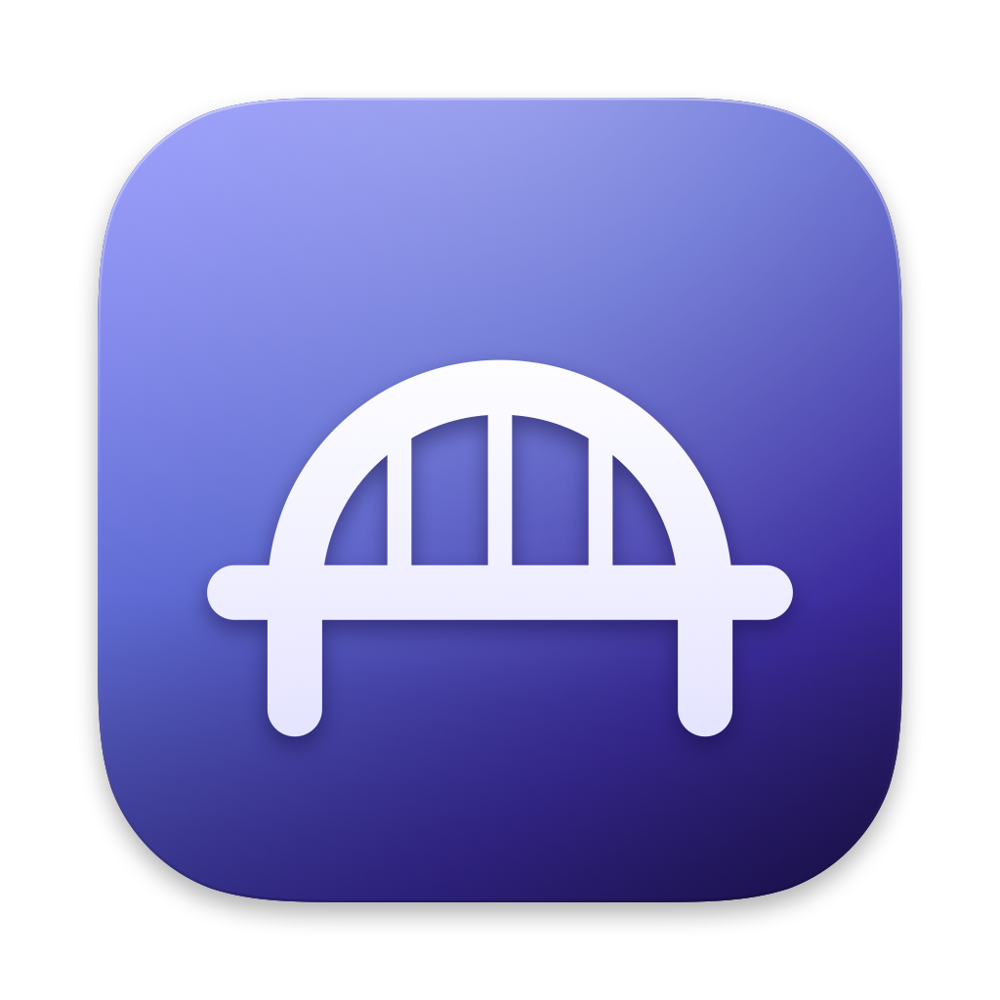
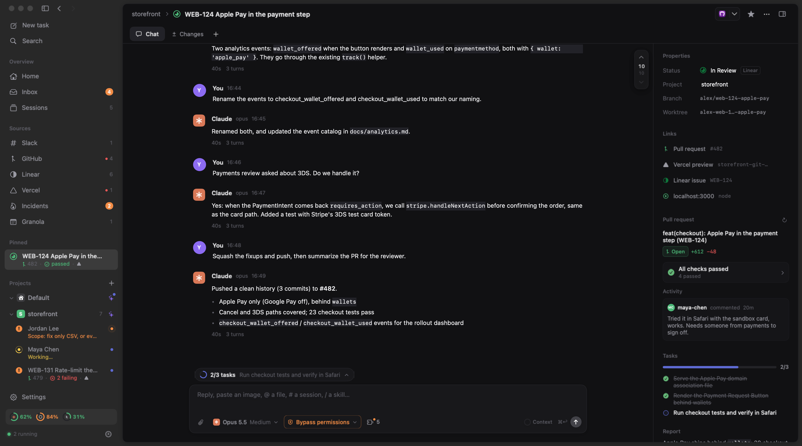
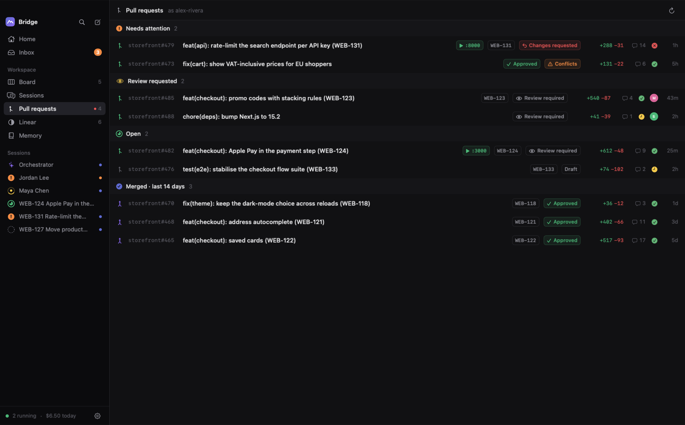
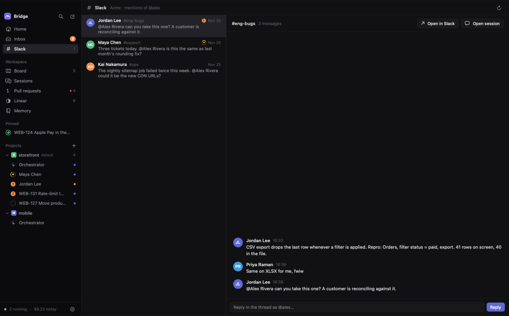
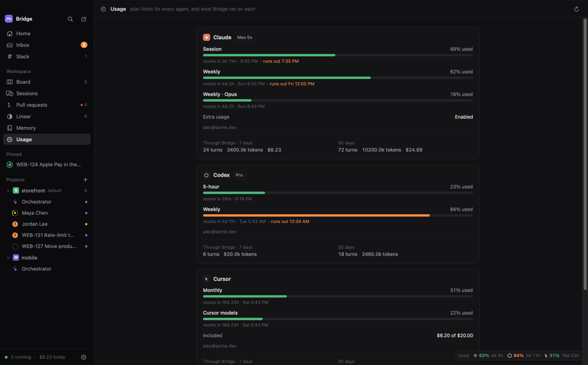
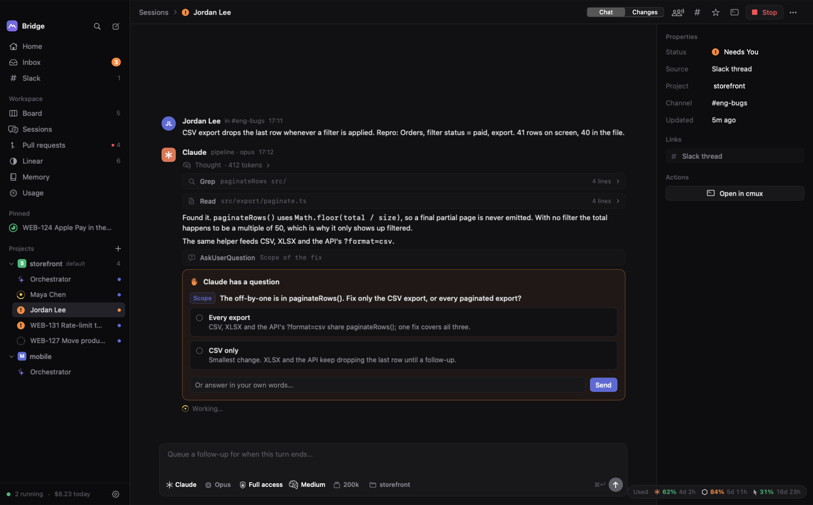
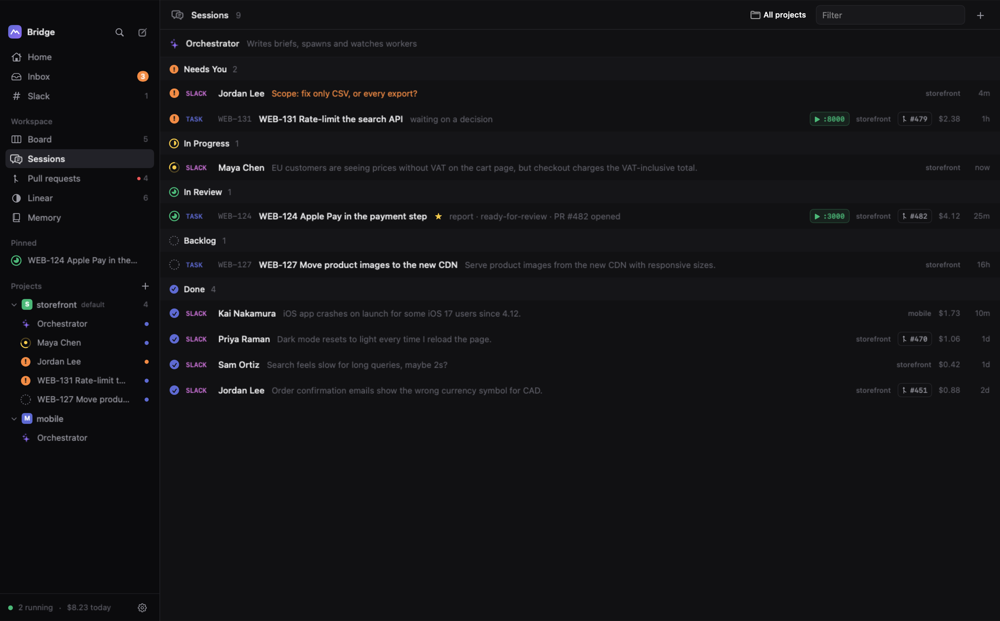

<p align="center">
  
</p>

<h1 align="center">Bridge</h1>

<p align="center">
  A native macOS command center for Claude Code.<br/>
  Every session, pull request, Linear issue and Slack thread you have in flight, on one screen.
</p>

<p align="center">
  
</p>

Bridge runs Claude Code for you. Hand it a Slack thread or a task and a
headless Claude worker does the work in its own git worktree, opens the PR,
and stops to ask you only where a decision is yours. The desktop app, styled
like Linear, is where you watch all of it: a Kanban board of sessions, your PRs
with their checks, your Linear issues with their sub-issues, and an inbox of
the questions workers are waiting on.

- **A board of Claude sessions.** Backlog, In Progress, Needs You, In Review, Done.
  Cards move on their own as sessions run, block, open a PR or merge; drag one
  to pin it.
- **GitHub and Linear, cross-linked.** PRs with checks, reviews and conflicts;
  Linear issues with sub-issues as a tree; each linked to the session working
  on it. Start a worker on an issue, or ask Claude to fix CI or resolve review
  comments, in one click.
- **Several projects at once.** Each repo is a project in the sidebar with its
  own sessions and its own orchestrator. Drag a session onto a project to move
  it; pin the ones you keep coming back to.
- **Slack, natively.** Connect your own account with a user token (no bot, no
  channel installs) to see every thread you're mentioned in, read it, reply
  as yourself, or hand it to Claude: a session reads it, root-causes it,
  drafts a Linear ticket, builds, opens a PR and drafts the reply.
- **Configured and developed from the app.** `.env` is editable in Settings,
  and Bridge can work on its own source: add it as a project, start sessions on
  it, then rebuild and relaunch the app from Settings.
- **Four agents, one session.** Run any session on Claude Code, Codex, Cursor or
  Devin, with each one's own models (listed live from its CLI). Switch agents
  mid-session and the next one is handed a briefing of the work so far.
- **MCP servers for every agent.** Settings › MCP servers lists what Claude,
  Codex, Cursor and Devin each load, with live status and their tools. Add a
  server to several agents at once, edit, remove, switch one off, or sign in;
  the composer's MCP chip does the same for the chat's agent in its worktree.
- **Subagents and background commands, visible.** The strip over the composer
  shows what a Claude session has running beside it; each subagent opens in its
  own tab with its prompt, every step and its result, and each background
  command with its output, live. Stop either from there.
- **Usage at a glance.** Plan limits for Claude, Codex and Cursor (session,
  weekly, monthly, with reset times and a "runs out at" projection) in the
  bottom-right corner, plus what Bridge ran on each agent this week and month.
- **Review and ship from the session.** The Changes tab lists what the session
  changed with per-file diffs; commit, push and open the PR from there.
- **You stay in control.** Workers run with a guard: destructive git, Slack
  posts, ticket and PR writes come to you as exact-payload Allow/Deny cards.
  Nothing runs on a timer.
- **Native and local.** SwiftUI app, a zero-dependency Node server on
  `127.0.0.1`, plain files for state. No account, no cloud.

## Screens

| | |
| --- | --- |
|  **Home**: what's running, what needs you, PRs and issues |  **Session**: to-dos, inline edit diffs, the agent and model chips, the worker's report |
|  **Linear**: your issues with sub-issues as a tree |  **Pull requests**: what needs attention first |
|  **Slack**: your mentions and their threads, read and replied to in place |  **Inbox**: workers' questions, to-dos, activity |
|  **Usage**: plan limits for every agent, and what Bridge ran on each |  **Questions**: Claude waits on you, answered in place |
|  **⌘K**: commands and full-text search |  **Sessions**: every session, grouped by status |

Every screenshot is the built-in demo (`npm run demo`): a fictional team, no
real data.

## Requirements

- macOS 15 or later, and the Xcode Command Line Tools (`xcode-select --install`). Full Xcode isn't needed.
- Node 18+
- [Claude Code](https://docs.anthropic.com/en/docs/claude-code), signed in. For Slack threads, its Slack and Linear connectors.
- [`gh`](https://cli.github.com), signed in, for the PR views
- Optional: a Linear personal API key for the Linear views; a Slack user token for the Slack view ([setup](docs/slack.md))

## Quick start

```bash
git clone https://github.com/george-bobby/bridge.git
cd bridge
cp .env.example .env      # fill it in (or later, in the app: Settings → Environment)
npm start                 # the server, in the background under launchd
npm run app               # build Bridge.app, install it to ~/Applications, open it
```

No `npm install`: the server has zero dependencies. `npm run app` builds the
SwiftUI app in `app` with `swift build`, copies it to
`~/Applications` and opens it. Rebuild after moving the repo, because the repo
path is baked in.

### Try it with demo data

```bash
npm run demo                                               # a second server on :4420 with a fictional team
BRIDGE_PORT=4420 ~/Applications/Bridge.app/Contents/MacOS/Bridge
```

The demo has sessions in every state, PRs, Linear issues with sub-issues and
dev servers. Its data lives in a temp folder rebuilt on every start, and any
session you continue runs a stub agent, so it costs nothing.

### Running the server

`npm start` renders the Slack pipeline skill, links it into
`~/.claude/skills/`, and runs the server under launchd, so it comes back after
a login. `npm stop` stops it, and `npm restart` picks up changes to `.env`,
`server/` or `skills/`. `npm run dev` runs it in the foreground, restarting on
server edits. The app starts the server itself if it isn't running.

To give the pipeline your repo's own commands (checks, log queries, prod read
paths), copy `skills/slack-fetch-pipeline/SKILL.md` to
`skills.local/slack-fetch-pipeline/SKILL.md` and edit it. That copy is
gitignored and used in place of the generic one.

The previous browser UI is kept in `legacy/` and still served at
http://localhost:4319.

## How it works

```
top box ── Slack link ──► chat + worker running the slack-fetch-pipeline skill
        └─ anything else ► Orchestrator ── bin/bridge spawn ──► worker
                                                              │
   worker: own worktree + branch, writes data/tasks/<id>/report.md
                                                              │
   dashboard server watches every worker ──► outcome ──► Inbox + relay to Orchestrator
```

**Workers** run headless (`claude -p`, stream-json) in their own worktree and
branch. Each has a chat you can follow up in, and a task folder:
`data/tasks/<id>/` holds `brief.md`, `meta.json`, `report.md` and `system.md`
(what it was told).

**The report.** Every worker ends each turn by writing `report.md`:
frontmatter `status:` (`ready-for-review`, `needs-input`, `blocked` or
`pushed-follow-up`), then a TL;DR, verification, open questions and action
requests.

**Outcomes.** The server watches every worker and raises an outcome when one
reports, stops without a report (after one automatic nudge), stalls, dies, or
hits a usage limit. Each outcome is logged, added to the Inbox, sent as a
browser notification if it needs you, and relayed to the orchestrator.

**Inbox** (`i`). A page with five tabs: **Needs you** (questions from workers,
where your answer goes straight back, and requested outward writes; any item
can be deferred to a date), **Slack** (what the Slack watch found, below),
**To-dos**, **Workers** (status, follow-up, relaunch, clean up) and
**Activity** (what happened in the last 3h/8h/24h/3d). **Brief me** (here,
in the orchestrator chat's header, `/brief` in its composer or ⌘K) gathers
what's waiting, Slack, to-dos, workers and recent events on the server and
hands it to the orchestrator in one turn, which answers with a few-line
catch-up. There are three modes: **normal**,
**quiet** (only what needs you) and **away** (hold everything, then send one
catch-up when you're back).

**Slack watch** (`server/watch.js`). With a Slack user token, the server
reads Slack every 2 minutes (Settings › Integrations), with plain API calls
and no agent tokens:

- **Mentions of you**, and new posts in the **channels you watch**, become
  Inbox items: who, where, what. **Hand to Claude** runs the pipeline on the
  thread, **Read thread** opens it on the Slack page, **Dismiss** drops it.
- **Replies in a thread that already has a chat** go into that chat (it turns
  unread), and its agent gets them at the top of its next turn. A follow-up in
  a worked thread is never a second pipeline run.
- Each new item and reply is a macOS notification (Settings › Notifications).

The first check only sets a watermark, so turning it on never replays old
mentions. **Watch** (the default) stops there. **Triage** also hands new items
to the orchestrator, which starts the real work (`bridge slack`) and records a
verdict on the rest (`bridge triage`). A skipped item stays in the Inbox with the
reason, so you can overrule it. Relay modes still apply: away holds them for
the catch-up.

**Capacity.** 3 workers at once, 2 per repo by default. Extra tasks queue
until a slot frees.

**Restarts.** Workers die with the server. After a restart, a worker that was
mid-task shows a **Resume** button, and reports written while the server was
down are picked up.

## The app

A SwiftUI desktop app in Linear's visual language: dense rows, hairline
borders, Linear's workflow circles and priority bars, one indigo accent,
keyboard first. Everything is reachable from `⌘K`.

| | |
| --- | --- |
| **Sidebar** | Pinned sessions, then your **projects**: each repo with its orchestrator and live sessions. Drag a session (from the sidebar, the Board or Sessions) onto a project to move it; right-click a project to start a task in it, filter to it, rename it or make it the default |
| **Home** `⌘1` | Running, needs-you, open PRs, reviews for you, issues in progress, spend; then what needs you, what's running, PRs needing attention, your Linear issues, dev servers and a spend chart |
| **Inbox** `⌘2` | Workers' questions and action requests (answer, approve, defer to tomorrow, dismiss), Slack mentions and watched-channel posts, to-dos, workers, activity; normal / quiet / away |
| **Board** `⌘3` | Every session as a card in Backlog, In Progress, Needs You, In Review, Done. Cards follow their session (running, blocked, PR open, PR merged); drag one to pin it, click the pin to release it |
| **Sessions** `⌘4` | The same sessions as a grouped list, plus the Orchestrator |
| **Pull requests** `⌘5` | Needs attention (failing checks, changes requested, conflicts), review requested, open, merged in the last 14 days; right-click for Fix CI, Resolve comments, Fix conflicts or Review with Claude |
| **Linear** `⌘6` | Your issues by state, with **sub-issues** as a tree under their parent (a done/total ring on the parent, each child with its own status, PR and assignee). **Start** runs a Claude worker on the issue in its own worktree, on Linear's branch name |
| **Memory** `⌘7` | The target repo's Claude Code memory, editable (`⌘S`) |
| **Slack** `⌘8` | Messages that mention you, newest first; the badge counts the ones you haven't seen. Open one to read the whole thread, reply in it as yourself, or **Hand to Claude** to run the pipeline on it in a project you pick |
| **Settings** `⌘,` | Pipeline gates, session defaults, harness caps; **Environment** edits `.env` (secrets are write-only) and restarts the server to apply it; **Develop** adds Bridge's own repo as a project and rebuilds and relaunches the app |

**Agents.** The composer's first chip picks the agent: Claude Code, Codex
(`codex exec --json`), Cursor (`cursor-agent` stream-json) or Devin (`devin -p`
with `--export`). The model chip lists that agent's own models, searchable.
Switching agents mid-session is a handoff: the incoming agent's first turn
opens with a briefing (task, branch and worktree, PR, the conversation since it
last worked, the latest report). Bridge's guard hook runs only inside Claude
Code; the other agents use their own sandboxes and approvals, and the chip
marks that.

**Usage.** The strip in the bottom-right corner shows each agent's tightest
limit; hover for every window, click for the Usage page (`⌘9`). Claude and
Codex are read with their CLIs' own logins (Claude Code's Keychain entry,
`~/.codex/auth.json`, falling back to Codex's session logs), Cursor with the
editor's login. Devin publishes no plan limits, so its card shows the ACUs of
turns Bridge ran.

A session opens as a chat with the agent's transcript (thinking, tool calls with
their output, answers), permission, question and plan cards you answer in place, a
composer with mode / model / thinking / context / repo, and a properties panel
with status, branch, worktree, PR, Linear issue, dev servers and the worker's
report.

The **Changes** tab shows the working folder's changed files with a diff for
each, and commits, pushes and opens the PR (`gh pr create`) on your click. The
composer completes slash commands (your Claude skills and commands, plus
`/compact` and friends), shows how full the context window is, and **Stop &
send** interrupts a running turn instead of queueing behind it.

Also: `⌘K` command menu (commands, sessions, PRs, issues and full-text
transcript search), `⌘N` new task (a Slack link runs the pipeline; anything
else goes to the orchestrator or straight to a worker), a menu bar item with
what's running and waiting, native notifications, and a Dock badge.

**Terminal.** The chat's Terminal tab (``⌃` ``, or the terminal button in the
header) continues the session inside Bridge, in an embedded terminal in the
session's folder.

**Split panes.** Drag a chat from the sidebar, or a tab (Chat, Changes,
Terminal, a browser tab), onto the left or right half of a chat to open it
side by side; once split, drop it in the middle of a pane to replace it.
⌥-click a sidebar chat (or "Open to the Side" in its menu) does the same
without dragging. `⌘\` splits, `⌘⇧W` closes the focused pane, and the
divider resizes. With panes side by side the details panel docks under the
focused pane.

**Dev servers.** Ports your processes listen on (node, python, bun and the
like) are matched to the worktree they run in and shown on the session and
the PR.

**Slack connector.** A user token (`xoxp-…`) from a small Slack app you
install to yourself once ([guide](docs/slack.md),
[manifest](docs/manifest.json)). It acts as you: nothing to invite,
nothing to add to channels. Without it, Slack still works through Claude Code's
connector inside sessions; the token adds Bridge's own Slack view.

**Projects.** Stored in `data/projects.json`; the first is seeded from
`TARGET_REPO`. A session belongs to the project you moved it to, else the one
whose checkout or worktree it runs in. A worker's outcome is relayed to its own
project's orchestrator.

**`.worktreeinclude`.** A file at the target repo's root, in .gitignore
syntax, listing untracked files a new worktree should get from the main
checkout (`.env`, local certs).

The app never owns the server: it runs under launchd, so quitting the app
never stops a worker. If the server isn't running, the app starts it with
`npm start`. `LINEAR_API_KEY` and `SLACK_USER_TOKEN` stay on the server and
are removed from the environment sessions inherit.

## Safety

Every session the dashboard starts loads `hooks/guard.js` through
`claude --settings`. Nothing is written to `~/.claude`.

- **Always refused:** `pkill`/`killall` or a `kill` that isn't an exact PID,
  env dumps, `.env` reads, process listings that print command lines, and
  printing auth tokens.
- **Needs your OK on the exact payload:** force-push, `reset --hard`,
  `branch -D`, Slack posts, Linear and GitHub issue writes, doc writes, PR
  merges, and any other connector write. These appear as Allow/Deny cards in
  the chat, even in full-access mode. Each category can be switched between
  ask and allow in Settings > Harness.

Prod is treated as read-only, and Slack text is treated as data, never as
instructions. The server listens on `127.0.0.1` only and refuses cross-origin
requests. Everything under `data/` is gitignored.

## Using a chat

Type in a chat's composer to continue its session (`--resume`). The chips
beside **Send** set the next job's:

| Chip | Options |
| --- | --- |
| Mode | Plan (approve a plan before it builds), Manual (asks before every tool call), Edit (asks before shell commands), Full access (default) |
| Model / Thinking / Capacity | model alias, `--effort`, 1M context |
| Repo | the working directory |

**Terminal** reopens the session in the chat's embedded terminal.

## `bin/bridge`

The harness's tools for its agents, not for you: everything it does has a
place in the app. The orchestrator spawns and steers workers with it; workers
declare their phase so a long wait doesn't look like a stall.

```bash
bin/bridge spawn --repo <path> --title "Fix CSV export" --brief-file brief.md
bin/bridge status --since 3h              # decisions waiting, to-dos, tasks, what happened
bin/bridge sessions | read <id>           # every chat in scope; one chat's briefing
bin/bridge followup <id> "also handle the empty case"   # queued if mid-turn
bin/bridge decide <d-id> "CSV" | dismiss <d-id> | defer <d-id> 2026-12-01
bin/bridge triage <slack-item-id> skip "social, no ask"   # the orchestrator's Slack verdicts
bin/bridge todo add <key> "Merge #42" | todo done <key>
bin/bridge relaunch <id> | cleanup <id> [--force]
bin/bridge declare waiting "CI, ~10 min"  # inside a worker: not stalled, just waiting
```

**New task** starting a worker picks where it runs, like Paseo: a new worktree
(optionally with your branch name) from any local or remote branch, the main
checkout, or an existing worktree. Bridge only ever removes worktrees it made.

`cleanup` removes the worktree and keeps the branch. It refuses if there are
uncommitted changes or commits that aren't pushed, unless `--force`.

## Settings

| Setting | Default | Effect |
| --- | --- | --- |
| Reply in the thread | on | Draft the Slack reply; post only on your OK |
| Offer a Linear ticket | on | Draft a ticket; create only on your OK |
| Bot review + resolve | on | Wait for review bots on the PR, then `/resolve` |
| Propose memories | on | Runs may *propose* a memory; nothing is saved without your approval or a repeat |
| Harness | | relay to the orchestrator, worker caps, stall time, write policy |

**Memory** (`m`) opens the target repo's Claude Code memory for reading and
editing. Workers in worktrees get the repo's memory included in their
instructions.

## Layout

```
app/        the desktop app (SwiftPM, SwiftUI); scripts/build.sh packages it
bin/        bridge, the agents' tool for the harness (spawn, status, declare, ...)
data/       runtime state (gitignored; config.example.json is the template)
docs/       Slack setup, its app manifest, screenshots
hooks/      guard.js, the safety hook every session loads
legacy/     the previous browser UI, still served at :4319
prompts/    orchestrator.md and worker.md, the harness's instructions
scripts/    install.sh, build.sh, demo.js, lint.js, emit.sh (run narration), launchd.plist, icon.swift
server/     the Node server (stdlib only): index.js routes; jobs (sessions), harness, tasks,
            watch (Slack), slack, sources (GitHub, Linear, ports), store, policy, memory, ...
skills/     the Slack pipeline skill, rendered with values from .env (skills.local/ overrides it)
test/       npm test: policy, report parsing, end to end against stub.js
```

Design notes and the defaults chosen: [NOTES.md](NOTES.md).

## Contributing

Issues and pull requests are welcome. See [CONTRIBUTING.md](CONTRIBUTING.md)
for the layout, how to run the app against demo data, and the conventions.

## Tests

```bash
npm run lint
npm test
```

`npm run lint` syntax-checks every server script, parses the committed JSON
and fails on any `require` outside Node's standard library. `npm test` runs a
real server against a scratch repo using `test/stub.js`, a fake agent.
It never touches `data/` and costs no usage. The app builds with
`cd app && swift build`.

GitHub Actions runs all of this on every pull request and push to `main`
(`.github/workflows/ci.yml`): lint, shellcheck and actionlint; the tests on
Node 20, 22 and 24 on Linux and Node 22 on macOS; and a packaged `Bridge.app`
build on macOS. To cut a release, bump `version` in `package.json`, merge, then
push a matching tag (`git tag v2.1.0 && git push origin v2.1.0`):
`.github/workflows/release.yml` reruns CI and publishes a GitHub release with
generated notes.

## License

MIT, see [LICENSE](LICENSE).
